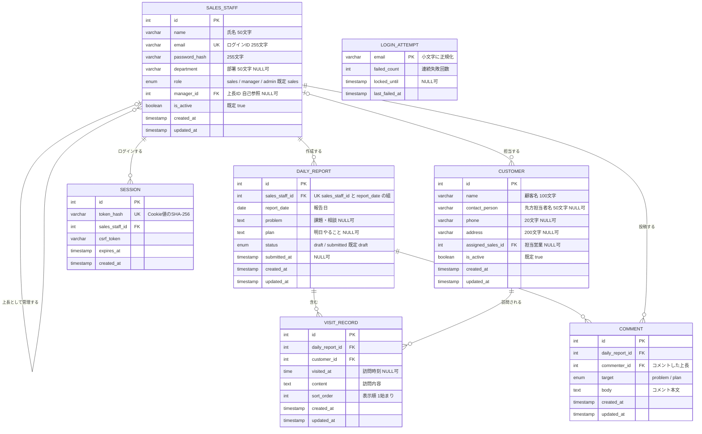

# 営業日報システム 要件定義書（ドラフト v0.2）

## 1. 目的・背景

営業担当者の日々の活動（顧客訪問・課題・翌日の予定）を記録・共有し、上長がタイムリーにフィードバックできる仕組みを提供する。

## 2. 利用者（アクター）

| アクター | 説明 |
|---|---|
| 営業担当者 | 日報を作成・提出する。自分の日報に付いたコメントを閲覧する |
| 上長 | 部下の日報を閲覧し、Problem / Plan にコメントする。自身も営業として日報を書くことがある |
| 管理者 | 顧客マスタ・営業マスタを管理する |

## 3. 機能要件

### 3.1 日報管理

| ID | 機能 | 詳細 |
|---|---|---|
| F-01 | 日報作成 | 営業担当者は1日につき1件の日報を作成できる（営業担当者 × 日付で一意） |
| F-02 | 訪問記録の登録 | 1件の日報に、訪問した顧客と訪問内容を **複数行** 登録できる。行の追加・編集・削除・並び替えが可能。訪問がない日（内勤日など）は0件でもよい |
| F-03 | Problem 記入 | 現在の課題・相談事項を記入できる |
| F-04 | Plan 記入 | 明日やることを記入できる |
| F-05 | 下書き保存・提出 | 日報は「下書き」「提出済み」のステータスを持つ。提出後に上長が閲覧可能になる |
| F-06 | 日報一覧・検索 | 日付範囲・営業担当者・顧客で日報を絞り込める |
| F-07 | 下書き削除 | 営業担当者は自分の下書きの日報を削除できる。提出済みの日報は削除できない |

### 3.2 コメント

| ID | 機能 | 詳細 |
|---|---|---|
| F-11 | コメント投稿 | 上長は部下の日報の Problem / Plan それぞれにコメントできる。1つの項目に複数コメント可 |
| F-12 | コメント閲覧 | 営業担当者は自分の日報に付いたコメントを閲覧できる |

### 3.3 マスタ管理

| ID | 機能 | 詳細 |
|---|---|---|
| F-21 | 顧客マスタ管理 | 顧客の登録・編集・削除（論理削除）・検索 |
| F-22 | 営業マスタ管理 | 営業担当者の登録・編集・削除（論理削除）。上長（所属上長）を設定できる |

### 3.4 認証・権限

| ID | 機能 | 詳細 |
|---|---|---|
| F-31 | ログイン | メールアドレス + パスワードでログインする |
| F-32 | 権限制御 | 下表のとおり |
| F-33 | ログイン試行回数の制限 | 同じメールアドレスで5回連続してログインに失敗したら、15分間そのメールアドレスでのログインを受け付けない |

| 操作 | 営業担当者 | 上長 | 管理者 |
|---|---|---|---|
| 自分の日報の作成・編集・下書き削除 | ○ | ○ | - |
| 部下の日報の閲覧 | - | ○ | ○ |
| Problem / Plan へのコメント | - | ○（部下の日報のみ） | - |
| マスタ管理 | - | - | ○ |

## 4. 非機能要件（たたき台）

| 項目 | 内容 |
|---|---|
| 利用端末 | PC ブラウザ、スマートフォンブラウザ（外出先からの入力を想定） |
| 実行環境 | ローカル環境（Node.js + docker compose の PostgreSQL）。本番環境へのデプロイは行わない（決定事項 #32）。ただし Google Cloud Run + Cloud SQL for PostgreSQL で動かせる設計は保つ |
| タイムゾーン | 業務上の日付・時刻は Asia/Tokyo（JST）を基準とする。サーバーは UTC で動くため、「今日」「未来日」の判定はアプリで JST に変換して行う |
| 可用性 | Cloud Run のように複数インスタンスで動く環境を想定する（インスタンスは随時入れ替わる）。そのためセッションやログイン失敗回数などの状態はメモリに持たず、DB に保存する |
| 想定規模 | 営業 200 人、日報 1 日あたり約 200 件（5 年で日報約 25 万件・訪問記録約 75 万件） |
| 性能 | 一覧画面の表示は 2 秒以内 |
| セキュリティ | 通信の HTTPS 化（デプロイする場合。決定事項 #32）、パスワードのハッシュ化保存、ログイン試行回数の制限（F-33） |
| データ保持 | 日報データは最低 5 年間保持する |

## 5. ER 図

物理名はテーブル名・カラム名（snake_case）で記載する。Prisma スキーマ（`prisma/schema.prisma`）ではモデル名・フィールド名を PascalCase / camelCase とし、`@@map` / `@map` でこの物理名に対応づける。

### テーブルの実装状況

| テーブル | Prisma モデル | 状況 |
|---|---|---|
| `sales_staff` / `customers` / `daily_reports` / `visit_records` / `comments` | `SalesStaff` / `Customer` / `DailyReport` / `VisitRecord` / `Comment` | `prisma/schema.prisma` に定義済み |
| `sessions` | `Session` | `prisma/schema.prisma` に定義済み（Issue #16） |
| `login_attempts` | `LoginAttempt` | Issue #43 で追加する（決定事項 #18） |

### 削除時の動作（外部キー）

| 親 → 子 | 親を削除したとき |
|---|---|
| 日報 → 訪問記録・コメント | 子も削除する（Cascade） |
| 営業 → 日報・コメント・部下 | 子が残っていれば削除できない（Restrict）。マスタは論理削除で運用する |
| 営業 → 担当顧客 | 顧客の担当営業を NULL にする（SetNull） |
| 顧客 → 訪問記録 | 訪問記録が残っていれば削除できない（Restrict） |
| 営業 → セッション | セッションも削除する（Cascade） |

### 設計上のポイント

- **日報と訪問記録を分離**：「1日に複数行」の要件を `DAILY_REPORT`（1日1件）と `VISIT_RECORD`（明細・複数行）の親子関係で表現。
- **Problem / Plan は日報本体のカラム**：1日1つずつの記入なので `DAILY_REPORT` に持たせる。
- **コメントは `target` で対象を区別**：Problem 用・Plan 用でテーブルを分けず、1テーブル + 区分カラムでシンプルにした。
- **上長は営業マスタの自己参照**：`SALES_STAFF.manager_id` で上下関係を表す。上長も日報を書ける。
- **ID は int**：BigInt は JavaScript では `bigint` 型になり、そのままでは JSON に変換できないため。int の上限（約21億）は想定規模（日報約25万件）に対して十分。
- **セッションは DB に保存**：Cloud Run は複数インスタンスで動くため。Cookie にはランダムなトークンを入れ、DB にはそのハッシュだけを保存する（DB が漏えいしてもセッションを乗っ取られないようにする）。
- **ログイン失敗回数はメールアドレス単位**：存在しないメールアドレスも同じように記録・ロックし、アカウントの有無を推測させない（決定事項 #18）。営業マスタとは外部キーでつながない。

## 6. 決定事項

作成時の未決事項は、[仕様決定記録](./decisions.md) の #1〜#6 で決定した。要点は次のとおり。

- 上長が閲覧できるのは直属の部下の日報のみ（#1）
- コメントへの返信・通知は初期リリースでは作らない（#2・#6）
- 訪問記録の項目は顧客・訪問時刻（任意）・訪問内容のみ（#3）
- 提出後の日報は、上長のコメントが付くまで本人が編集できる（#4）
- 顧客の担当営業は1人（#5）
