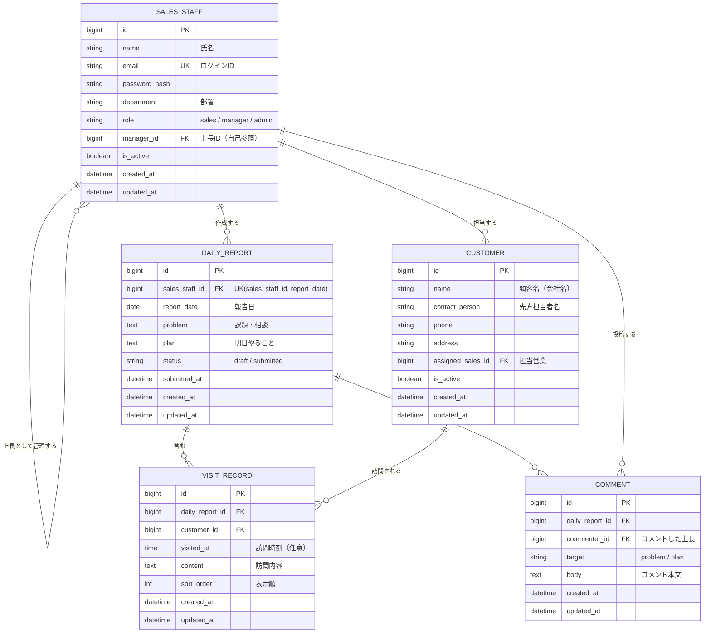

# 営業日報システム 要件定義書（ドラフト v0.1）

## 1. 目的・背景

営業担当者の日々の活動（顧客訪問・課題・翌日の予定）を記録・共有し、上長がタイムリーにフィードバックできる仕組みを提供する。

## 2. 利用者（アクター）

| アクター | 説明 |
|---|---|
| 営業担当者 | 日報を作成・提出する。自分の日報に付いたコメントを閲覧する |
| 上長 | 部下の日報を閲覧し、Problem / Plan にコメントする。自身も営業として日報を書くことがある |
| 管理者 | 顧客マスタ・営業マスタを管理する |

## 3. 機能要件

### 3.1 日報管理

| ID | 機能 | 詳細 |
|---|---|---|
| F-01 | 日報作成 | 営業担当者は1日につき1件の日報を作成できる（営業担当者 × 日付で一意） |
| F-02 | 訪問記録の登録 | 1件の日報に、訪問した顧客と訪問内容を **複数行** 登録できる。行の追加・編集・削除・並び替えが可能 |
| F-03 | Problem 記入 | 現在の課題・相談事項を記入できる |
| F-04 | Plan 記入 | 明日やることを記入できる |
| F-05 | 下書き保存・提出 | 日報は「下書き」「提出済み」のステータスを持つ。提出後に上長が閲覧可能になる |
| F-06 | 日報一覧・検索 | 日付範囲・営業担当者・顧客で日報を絞り込める |

### 3.2 コメント

| ID | 機能 | 詳細 |
|---|---|---|
| F-11 | コメント投稿 | 上長は部下の日報の Problem / Plan それぞれにコメントできる。1つの項目に複数コメント可 |
| F-12 | コメント閲覧 | 営業担当者は自分の日報に付いたコメントを閲覧できる |

### 3.3 マスタ管理

| ID | 機能 | 詳細 |
|---|---|---|
| F-21 | 顧客マスタ管理 | 顧客の登録・編集・削除（論理削除）・検索 |
| F-22 | 営業マスタ管理 | 営業担当者の登録・編集・削除（論理削除）。上長（所属上長）を設定できる |

### 3.4 認証・権限

| ID | 機能 | 詳細 |
|---|---|---|
| F-31 | ログイン | メールアドレス + パスワードでログインする |
| F-32 | 権限制御 | 下表のとおり |

| 操作 | 営業担当者 | 上長 | 管理者 |
|---|---|---|---|
| 自分の日報の作成・編集 | ○ | ○ | - |
| 部下の日報の閲覧 | - | ○ | ○ |
| Problem / Plan へのコメント | - | ○（部下の日報のみ） | - |
| マスタ管理 | - | - | ○ |

## 4. 非機能要件（たたき台）

| 項目 | 内容 |
|---|---|
| 利用端末 | PC ブラウザ、スマートフォンブラウザ（外出先からの入力を想定） |
| 性能 | 一覧画面の表示は 2 秒以内 |
| セキュリティ | 通信の HTTPS 化、パスワードのハッシュ化保存 |
| データ保持 | 日報データは削除せず保持（期間は要確認） |

## 5. ER 図

### 設計上のポイント

- **日報と訪問記録を分離**：「1日に複数行」の要件を `DAILY_REPORT`（1日1件）と `VISIT_RECORD`（明細・複数行）の親子関係で表現。
- **Problem / Plan は日報本体のカラム**：1日1つずつの記入なので `DAILY_REPORT` に持たせる。
- **コメントは `target` で対象を区別**：Problem 用・Plan 用でテーブルを分けず、1テーブル + 区分カラムでシンプルにした。
- **上長は営業マスタの自己参照**：`SALES_STAFF.manager_id` で上下関係を表す。上長も日報を書ける。

## 6. 確認したい事項（オープン課題）

1. 上長は「直属の部下」の日報だけ見られる想定でよいか？（部署単位・全員閲覧などの可能性）
2. コメントへの返信（営業 → 上長）やスレッド形式は必要か？
3. 訪問記録に「訪問時刻」「訪問目的（新規/既存フォロー等）」「次回アクション」などの項目は必要か？
4. 提出後の日報は編集可能か？（上長コメント後はロックする等）
5. 顧客マスタに担当営業を持たせるか？（複数担当がありうるなら中間テーブルが必要）
6. 通知（日報提出時に上長へ、コメント時に営業へ）は必要か？
