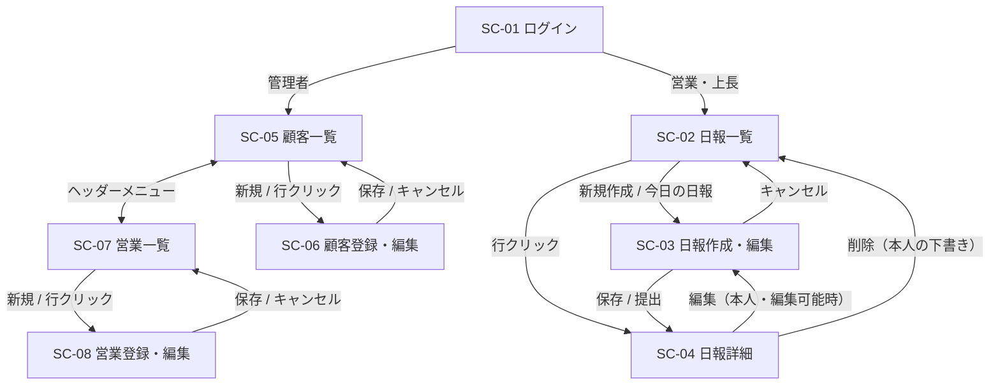

# 営業日報システム 画面定義書（ドラフト v0.2）

> 前提：[要件定義書](./requirements.md) と [仕様決定記録](./decisions.md) に基づく。

## 1. 画面一覧

| 画面ID | 画面名 | URL | 利用者 | 概要 | 対応機能 |
|---|---|---|---|---|---|
| SC-01 | ログイン | `/login` | 全員 | メールアドレスとパスワードで認証 | F-31 |
| SC-02 | 日報一覧 | `/reports` | 営業・上長 | 自分（上長は部下も）の日報を一覧・検索 | F-06 |
| SC-03 | 日報作成・編集 | `/reports/new`・`/reports/{id}/edit` | 営業・上長 | 訪問記録（複数行）・Problem・Plan を入力 | F-01〜F-05 |
| SC-04 | 日報詳細 | `/reports/{id}` | 営業・上長 | 日報の閲覧、下書きの削除、上長によるコメント投稿 | F-07, F-11, F-12 |
| SC-05 | 顧客一覧 | `/customers` | 管理者 | 顧客マスタの一覧・検索 | F-21 |
| SC-06 | 顧客登録・編集 | `/customers/new`・`/customers/{id}` | 管理者 | 顧客の登録・編集・無効化 | F-21 |
| SC-07 | 営業一覧 | `/staff` | 管理者 | 営業マスタの一覧・検索 | F-22 |
| SC-08 | 営業登録・編集 | `/staff/new`・`/staff/{id}` | 管理者 | 営業担当者の登録・編集・無効化、上長設定 | F-22 |

## 2. 画面遷移図



## 3. 共通仕様

### 3.1 共通レイアウト

```
+--------------------------------------------------------------+
| 営業日報システム    [日報一覧] [顧客] [営業]   山田太郎 ▼ ログアウト |
+--------------------------------------------------------------+
|                                                              |
|                        （各画面の内容）                         |
|                                                              |
+--------------------------------------------------------------+
```

- ヘッダーメニューはロールに応じて出し分ける
  - 営業・上長：日報一覧
  - 管理者：顧客、営業
- ユーザー名をクリックするとメニューが開き、「ログアウト」を選べる
- スマートフォン幅では、メニュー（日報一覧・顧客・営業）を左端の「≡」ボタンの中に折りたたむ
- ログイン画面・403 画面・404 画面にはヘッダーを出さない
- 未ログインでログイン画面以外にアクセスした場合は SC-01 へリダイレクト。ログイン後に元の画面へ戻れるよう、URL に `?next=元の画面のパス` を付ける（このサイトの中のパスだけを受け付ける）
- ログイン済みで SC-01 を開いた場合は、`next` の画面か、ロールごとのトップ画面（営業・上長は SC-02、管理者は SC-05）へ移る。`/` を開いた場合も同じトップ画面へ移る
- 権限のない画面（営業・上長が SC-05〜SC-08、管理者が SC-02〜SC-04）にアクセスした場合は 403 エラー画面（「アクセスできません」）を表示
- 存在しない URL、および閲覧できない日報は 404 エラー画面（「見つかりません」）を表示する（存在を推測させない）
- 画面の URL と、アクセス制御の実装方法は決定事項 #28

### 3.2 共通ルール

| 項目 | 仕様 |
|---|---|
| 日付表示 | `YYYY/MM/DD（曜）` |
| 日時表示 | `YYYY/MM/DD HH:mm` |
| 一覧のページング | 1ページ 20 件 |
| 必須項目 | ラベル横に `*` を表示 |
| 入力エラー | 項目の直下に赤字でメッセージ表示 |
| 未保存の離脱 | 入力中に画面遷移しようとした場合、確認ダイアログを表示（アプリ内のリンク・キャンセルボタン・ログアウトは M-07、ブラウザを閉じる・再読み込みはブラウザ標準の確認。ブラウザの「戻る」は対象外。決定事項 #29） |
| レスポンシブ | スマートフォン幅では表を縦積みのカード表示に切り替える |

## 4. 画面詳細

---

### SC-01 ログイン

**目的**：システムへの認証

```
+-------------------------------+
|        営業日報システム          |
|                               |
|  メールアドレス *               |
|  [___________________________] |
|  パスワード *                   |
|  [___________________________] |
|                               |
|          [ ログイン ]           |
+-------------------------------+
```

| 項目名 | 種類 | 必須 | 仕様 |
|---|---|---|---|
| メールアドレス | テキスト | ○ | メール形式 |
| パスワード | パスワード | ○ | |
| ログイン | ボタン | | 認証成功時、ロールに応じて遷移（営業・上長→SC-02、管理者→SC-05） |

**エラー**
- 認証失敗：「メールアドレスまたはパスワードが正しくありません」
- 無効化されたアカウント：同上（存在有無を推測させない）
- ログイン試行回数の上限（同じメールアドレスで5回連続失敗）：M-13 を表示し、15分間はそのメールアドレスでログインできない。存在しないメールアドレスでも同じ動作にする
- M-01・M-13 はフォームの上に表示する。表示したらパスワード欄を空にしてカーソルを移し、メールアドレスはそのまま残す
- ログイン後の移動先は、URL に `?next=` があればその画面（このサイトの中のパスだけ。決定事項 #28）、なければロールごとのトップ画面
- 送信中と、ログインして画面が移るまでの間は、ボタンを「ログインしています…」にして押せなくする（二重送信の防止）
- メール形式のチェックは画面だけで行う（API では行わない。形式が違えば該当するアカウントがなく、M-01 になるだけのため）

---

### SC-02 日報一覧

**目的**：日報の一覧表示・検索。ログイン後のトップ画面。

```
+--------------------------------------------------------------+
| 日報一覧                                  [ 今日の日報を書く ] |
|                                                              |
| 期間 [2026/10/01]〜[2026/10/31]  担当者 [全員 ▼]  顧客 [____] |
|                                                    [ 検索 ]  |
|--------------------------------------------------------------|
| 日付          | 担当者   | 顧客               | 訪問件数 | ステータス | コメント |
|---------------|----------|--------------------|----------|------------|----------|
| 2026/10/31(土)| 山田太郎 | ABC商事、XYZ工業   |    3     | 提出済み   |   2 件   |
| 2026/10/30(金)| 山田太郎 | XYZ工業            |    2     | 下書き     |   -      |
| 2026/10/30(金)| 佐藤花子 | DEF物産            |    4     | 提出済み   |   0 件 ● |
+--------------------------------------------------------------+
                                            < 1 2 3 >
```

**検索条件**

| 項目名 | 種類 | 初期値 | 仕様 |
|---|---|---|---|
| 期間（開始） | 日付 | 当月1日 | |
| 期間（終了） | 日付 | 今日 | 開始日以降であること |
| 担当者 | セレクト | 上長：全員 / 営業：非表示 | 上長のみ表示。選択肢は「自分」＋直属の部下 |
| 顧客 | テキスト | 空 | 顧客名の部分一致。訪問記録に該当顧客を含む日報を抽出 |

**一覧項目**

| 項目名 | 仕様 |
|---|---|
| 日付 | `report_date`。降順で表示 |
| 担当者 | 営業担当者名 |
| 顧客 | 訪問した顧客名を「、」区切りで表示（重複なし・訪問記録の順）。訪問記録が 0 件なら「-」 |
| 訪問件数 | 訪問記録の件数 |
| ステータス | 下書き / 提出済み |
| コメント | コメント件数。上長視点で未コメントの提出済み日報には「●」を表示 |

**表示対象**
- 営業：自分の日報のみ
- 上長：自分の日報 ＋ 直属の部下の **提出済み** 日報（部下の下書きは表示しない）

**操作**

| 操作 | 動作 |
|---|---|
| 今日の日報を書く | 今日の日報が未作成なら SC-03（新規）、作成済みなら SC-03（編集）へ |
| 行クリック | SC-04 へ |
| 検索 | 条件で再検索。条件は URL クエリに保持する |

- 検索条件・ページ番号は URL のクエリ（`date_from`・`date_to`・`sales_staff_id`・`customer_name`・`page`）に保持する。詳細画面から戻っても条件が残る（T-UI-06）
- 期間を URL で指定していなければ、初期値（当月 1 日〜今日。JST）で検索する。正しくない値（`page=abc`・終了日が開始日より前 など）があれば、条件なし（期間は初期値）の 1 ページ目を表示する。閲覧できない担当者を指定したときは 403 画面
- 期間（終了）が期間（開始）より前のまま「検索」を押すと、期間の下にエラーを出して検索しない
- 担当者セレクトの選択肢は「全員・自分・直属の部下（有効な人。ID の順）」（T-UI-04）
- 一覧の上に件数を表示する。該当する日報がなければ「該当する日報はありません」と表示する。読み込み中はスケルトンを表示する
- コメント欄は「n 件」。下書きは「-」（コメントできないため）。「●」は上長から見てコメントがまだない部下の提出済み日報に付ける（T-UI-05）
- 「今日の日報を書く」は、自分の今日（JST）の日報があれば SC-03（編集。`/reports/{id}/edit`）、なければ SC-03（新規。`/reports/new`）へのリンクにする（T-UI-07・08）

---

### SC-03 日報作成・編集

**目的**：その日の訪問記録・Problem・Plan を入力する

```
+--------------------------------------------------------------+
| 日報作成                                                       |
|                                                              |
| 報告日 * [2026/10/31]                                         |
|                                                              |
| ■ 訪問記録                                                    |
| +----+----------------+-------+----------------------+-----+ |
| | ≡  | 顧客 *         | 時刻  | 訪問内容 *           |     | |
| +----+----------------+-------+----------------------+-----+ |
| | ≡  | [ABC商事    ▼] |[10:00]| [新商品の提案...   ] | [×] | |
| | ≡  | [XYZ工業    ▼] |[14:30]| [見積提出...       ] | [×] | |
| +----+----------------+-------+----------------------+-----+ |
| [ + 訪問記録を追加 ]                                           |
|                                                              |
| ■ Problem（課題・相談）                                        |
| [                                                          ] |
| [                                                          ] |
|                                                              |
| ■ Plan（明日やること）                                         |
| [                                                          ] |
| [                                                          ] |
|                                                              |
|          [ キャンセル ]  [ 下書き保存 ]  [ 提出する ]           |
+--------------------------------------------------------------+
```

**入力項目**

| 項目名 | 種類 | 必須 | 仕様 |
|---|---|---|---|
| 報告日 | 日付 | ○ | 初期値は今日。未来日は不可。同一担当者・同一日付の日報が既にある場合はエラー。編集時は変更不可 |
| 訪問記録：並び順 | ドラッグハンドル | | ドラッグで並び替え。`sort_order` に反映 |
| 訪問記録：顧客 | 検索付きセレクト | ○ | 有効な顧客マスタから選択。顧客名で絞り込み可能 |
| 訪問記録：時刻 | 時刻 | | 任意 |
| 訪問記録：訪問内容 | テキストエリア | ○ | 最大 2,000 文字 |
| 訪問記録：削除 | ボタン | | 行を削除（確認なし、保存前なら元に戻せる） |
| 訪問記録を追加 | ボタン | | 空行を末尾に追加。最大 20 行 |
| Problem | テキストエリア | 提出時○ | 最大 2,000 文字 |
| Plan | テキストエリア | 提出時○ | 最大 2,000 文字 |

**操作**

| 操作 | 動作 |
|---|---|
| キャンセル | 変更を破棄して前の画面へ（未保存なら確認ダイアログ） |
| 下書き保存 | 必須チェックは報告日のみ。`status = draft` で保存し SC-04 へ |
| 提出する | 全必須チェック（Problem・Plan 入力済み）後、確認ダイアログ →`status = submitted`、`submitted_at` を記録し SC-04 へ |

**補足**
- 提出済みの日報は、**上長のコメントが付くまでは編集できる**（決定事項 #4）。編集時の再保存ボタンは「更新する」と表示し、ステータスは提出済みのまま。
- 訪問がなかった日（内勤日など）は、訪問記録 0 件のまま提出できる（決定事項 #8）。
- 新規と編集で同じフォームを使う。見出しは新規が「日報作成」、編集が「日報編集」。編集時は報告日を入力できない状態で表示する（T-UI-16）
- 「提出する」の確認ダイアログ（M-06）は、初めて提出するときだけ出す。提出済みの日報の「更新する」では出さない
- 保存したら M-09（下書き保存・更新は「保存しました」、提出は「提出しました」）を出して SC-04 に移る。保存中はボタンを押せなくし、押したボタンの文言を「保存しています…」にする
- 同じ日付の日報がある（`409 REPORT_ALREADY_EXISTS`）ときは、M-04 を報告日の下に出す。その他の API の入力エラーは該当する項目の下に、項目に結び付けられないエラー（コメントが付いて編集できなくなった `409 REPORT_LOCKED` など）はトーストで出す
- Problem・Plan の下に、残りの入力文字数を出す
- キャンセルは、新規なら SC-02、編集なら SC-04 に戻る
- 訪問記録の行は、PC では横に並べ、スマートフォン幅では 1 行をカードにして縦に並べる。「訪問記録を追加」の横に今の行数（`n / 20 件`）を出し、20 行になったら押せなくする（T-UI-11）
- 並べ替えは行の左端のハンドルをドラッグする。キーボードでは、ハンドルでスペースキーを押して持ち上げ、上下の矢印キーで動かし、スペースキーで置く（T-UI-10）
- 顧客セレクトは、顧客名の一部を入力して絞り込める（大文字・小文字を区別しない部分一致。T-UI-12）。選択肢は有効な顧客だけ。編集する日報で無効になった顧客の行は「（無効）」を付けて表示し、顧客を変えなければそのまま保存できる（決定事項 #36）
- 何も入力していない行（顧客・時刻・訪問内容がすべて空）は、保存・提出の前に取り除く（docs/api.md R-02）。一部だけ入力した行は、顧客・訪問内容の必須エラーをその行の項目の下に出す（T-UI-13）
- 編集の URL（`/reports/{id}/edit`）で、閲覧できない・存在しない日報は 404 画面。閲覧はできるが編集できない日報（コメント付きの日報、上長から見た部下の日報）は SC-04 へ移る

---

### SC-04 日報詳細

**目的**：日報の閲覧と、上長による Problem / Plan へのコメント

```
+--------------------------------------------------------------+
| 日報詳細                [ 削除 ]  [ 編集 ]  [ 一覧へ戻る ]     |
|                                                              |
| 2026/10/31（土）  山田太郎   ステータス：提出済み              |
|                             提出日時：2026/10/31 18:05        |
|                                                              |
| ■ 訪問記録                                                    |
| | 時刻  | 顧客      | 訪問内容                              | |
| | 10:00 | ABC商事   | 新商品の提案。先方部長が興味あり...   | |
| | 14:30 | XYZ工業   | 見積提出。来週回答予定。              | |
|                                                              |
| ■ Problem（課題・相談）                                        |
|   XYZ工業の値引き要求にどこまで応じるべきか相談したい。         |
|   ┌────────────────────────────────────────────┐             |
|   │ 鈴木部長  2026/10/31 19:10                  │             |
|   │ 5%までなら即決OK。それ以上は相談して。       │             |
|   └────────────────────────────────────────────┘             |
|   [ コメントを入力...                       ] [ 投稿 ]  ←上長のみ |
|                                                              |
| ■ Plan（明日やること）                                         |
|   ABC商事へ資料送付、DEF社アポ取り                              |
|   （コメントはまだありません）                                  |
|   [ コメントを入力...                       ] [ 投稿 ]  ←上長のみ |
+--------------------------------------------------------------+
```

**表示項目**

| 項目名 | 仕様 |
|---|---|
| 報告日 / 担当者 / ステータス / 提出日時 | ヘッダーに表示。下書き時は提出日時を表示しない |
| 訪問記録 | `sort_order` 順に表示。訪問内容は改行を保持 |
| Problem / Plan | 改行を保持して表示 |
| コメント | 各セクション（Problem / Plan）の下に、投稿日時の昇順で表示。投稿者名・投稿日時・本文 |

**入力項目（上長のみ）**

| 項目名 | 種類 | 必須 | 仕様 |
|---|---|---|---|
| Problem へのコメント | テキストエリア | ○ | 最大 1,000 文字。`target = problem` で保存 |
| Plan へのコメント | テキストエリア | ○ | 最大 1,000 文字。`target = plan` で保存 |

**操作**

| 操作 | 表示条件 | 動作 |
|---|---|---|
| 編集 | 本人の日報、かつ編集可能な状態 | SC-03（編集）へ |
| 削除 | 本人の日報、かつ下書き | 確認ダイアログ（M-12）の後に削除し、SC-02 へ（決定事項 #13） |
| 一覧へ戻る | 常時 | SC-02 へ（検索条件を保持） |
| 投稿 | 閲覧者が日報作成者の上長、かつ日報が提出済み | コメントを保存し、同画面を再表示 |
| コメントの編集・削除 | 自分が投稿したコメント | コメント横の「…」メニューから実行（削除は確認ダイアログあり） |

**アクセス制御**
- 本人：常に閲覧可
- 上長：直属の部下の提出済み日報のみ閲覧可
- それ以外：404 画面（「見つかりません」。日報の存在を推測させないため、存在しない日報と同じにする。docs/api.md §1.5・SC-T-04）

---

### SC-05 顧客一覧

**目的**：顧客マスタの一覧・検索

```
+--------------------------------------------------------------+
| 顧客一覧                                         [ 新規登録 ] |
|                                                              |
| 顧客名 [________]  担当営業 [全員 ▼]  [ ] 無効も表示  [ 検索 ] |
|--------------------------------------------------------------|
| 顧客名     | 先方担当者 | 電話番号      | 担当営業 | 状態  |
| ABC商事    | 田中様     | 03-xxxx-xxxx | 山田太郎 | 有効  |
| XYZ工業    | 高橋様     | 06-xxxx-xxxx | 山田太郎 | 有効  |
+--------------------------------------------------------------+
```

| 項目 | 仕様 |
|---|---|
| 検索：顧客名 | 部分一致 |
| 検索：担当営業 | 営業マスタから選択 |
| 検索：無効も表示 | チェック時、`is_active = false` も表示 |
| 一覧 | 顧客名の昇順 |
| 新規登録 | SC-06（新規）へ |
| 行クリック | SC-06（編集）へ |

- 検索：担当営業の選択肢は、有効な営業・上長（顧客の担当に指定できる人。決定事項 #30）と「全員」
- 検索条件・ページ番号は URL のクエリ（`name`・`assigned_sales_id`・`include_inactive`・`page`）に保持する。正しくない値（`page=abc` など）があれば、条件なしの 1 ページ目を表示する
- 一覧の上に件数を表示する。該当する顧客がなければ「該当する顧客はありません」と表示する
- 未設定の項目（先方担当者・電話番号・担当営業）は「-」と表示する

---

### SC-06 顧客登録・編集

```
+-------------------------------------------+
| 顧客登録                                   |
|                                           |
| 顧客名 *     [___________________________] |
| 先方担当者   [___________________________] |
| 電話番号     [___________________________] |
| 住所         [___________________________] |
| 担当営業     [選択してください ▼]          |
| 状態         (●) 有効  ( ) 無効            |
|                                           |
|           [ キャンセル ]  [ 保存 ]          |
+-------------------------------------------+
```

| 項目名 | 種類 | 必須 | 仕様 |
|---|---|---|---|
| 顧客名 | テキスト | ○ | 最大 100 文字 |
| 先方担当者 | テキスト | | 最大 50 文字 |
| 電話番号 | テキスト | | `0` で始まる 10〜11 桁の数字。ハイフンなしか「市外局番-市内局番-加入者番号」の形（例：`03-1234-5678`。決定事項 #32） |
| 住所 | テキスト | | 最大 200 文字 |
| 担当営業 | セレクト | | 有効な営業担当者から選択 |
| 状態 | ラジオ | ○ | 新規時は「有効」固定（非表示）。無効にした顧客は日報入力の選択肢に出ない。過去の訪問記録には表示し続ける |

- 新規と編集で同じフォームを使う。見出しは新規が「顧客登録」、編集が「顧客編集」
- 担当営業の選択肢は「未設定」と、有効な営業・上長（決定事項 #30）。編集時に今の担当営業が無効になっている場合は、「（無効）」を付けて選択肢に残し、選ばれたままにする（付け替えずに他の項目を直せるようにするため。決定事項 #30）
- 未入力の任意項目は未設定として保存する。編集で空欄にした項目も未設定になる
- 保存したら M-09（保存しました）を出して SC-05 に戻る。保存中はボタンを「保存しています…」にして押せなくする
- API の入力エラー（担当営業が無効になっていた など）は、該当する項目の下に出す。それ以外のエラーはトーストで出す
- 存在しない顧客・数字でない ID の URL（`/customers/abc`）は 404 画面

---

### SC-07 営業一覧

**目的**：営業マスタの一覧・検索

```
+--------------------------------------------------------------+
| 営業一覧                                         [ 新規登録 ] |
|                                                              |
| 氏名 [________]  部署 [全て ▼]  [ ] 無効も表示      [ 検索 ] |
|--------------------------------------------------------------|
| 氏名     | メールアドレス     | 部署   | 権限   | 上長     | 状態 |
| 鈴木一郎 | suzuki@example.com | 営業1課 | 上長   | -        | 有効 |
| 山田太郎 | yamada@example.com | 営業1課 | 営業   | 鈴木一郎 | 有効 |
+--------------------------------------------------------------+
```

| 項目 | 仕様 |
|---|---|
| 検索：氏名 | 部分一致 |
| 検索：部署 | 登録済みの部署から選択 |
| 一覧 | 部署 → 氏名の昇順 |
| 新規登録 / 行クリック | SC-08 へ |

- 検索：部署の選択肢は「全て」と、登録済みの部署（無効な担当者の部署も含む。重複なし・昇順）
- 検索条件・ページ番号は URL のクエリ（`name`・`department`・`include_inactive`・`page`）に保持する。正しくない値（`page=abc` など）があれば、条件なしの 1 ページ目を表示する
- 一覧の上に件数を表示する。該当する担当者がいなければ「該当する営業担当者はいません」と表示する
- 未設定の項目（部署・上長）は「-」と表示する。部署が未設定の担当者は一覧の最後に並ぶ（決定事項 #31）

---

### SC-08 営業登録・編集

```
+-------------------------------------------+
| 営業登録                                   |
|                                           |
| 氏名 *           [_______________________] |
| メールアドレス *  [_______________________] |
| パスワード *      [_______________________] |
| 部署             [_______________________] |
| 権限 *           ( ) 営業 ( ) 上長 ( ) 管理者 |
| 上長             [選択してください ▼]      |
| 状態             (●) 有効  ( ) 無効        |
|                                           |
|           [ キャンセル ]  [ 保存 ]          |
+-------------------------------------------+
```

| 項目名 | 種類 | 必須 | 仕様 |
|---|---|---|---|
| 氏名 | テキスト | ○ | 最大 50 文字 |
| メールアドレス | テキスト | ○ | メール形式。重複不可 |
| パスワード | パスワード | 新規時○ | 8〜64 文字、英字と数字を各 1 文字以上含む（決定事項 #25）。編集時は空欄なら変更しない。パスワードは管理者が決め、本人による変更の機能はない（決定事項 #34） |
| 部署 | テキスト | | 最大 50 文字 |
| 権限 | ラジオ | ○ | sales / manager / admin |
| 上長 | セレクト | | 権限が「上長」の有効な担当者から選択。自分自身・自分の部下は選択不可（循環防止）。権限が「上長」の担当者には設定できない（未設定に固定。決定事項 #35） |
| 状態 | ラジオ | ○ | 無効にするとログイン不可。部下がいる上長を無効にする場合は警告を表示 |

- 新規と編集で同じフォームを使う。見出しは新規が「営業登録」、編集が「営業編集」。状態は編集時だけ表示する（新規は有効で登録する）
- パスワードは、新規では必須。編集では「変更する場合のみ入力してください」と表示し、空欄なら送らない（変更しない）
- 権限の初期値は「営業」
- 権限で「上長」を選ぶと、上長を「未設定」に戻して選べなくする（決定事項 #35）。権限が「上長」の人を編集するときも、上長は「未設定」で選べない
- 上長の選択肢は「未設定」と、有効な上長。編集時は本人と配下（部下・部下の部下…）を出さない（T-UI-23）。今の上長が無効になっている場合は、「（無効）」を付けて選択肢に残し、選ばれたままにする（docs/api.md S-04）
- 部下の警告（M-11）は、有効な部下がいる人を有効から無効に変えて保存するときに出す（決定事項 #17）。「キャンセル」を選んだら保存しない
- ログイン中の管理者が自分を編集するときは、権限と状態を変更できないようにする（docs/api.md S-04）
- メールアドレスの重複（M-10）は、メールアドレス欄の下に出す。API の入力エラーは該当する項目の下に、それ以外のエラー（部下がいる上長の権限変更の 409 など）はトーストで出す
- 保存したら M-09（保存しました）を出して SC-07 に戻る。保存中はボタンを「保存しています…」にして押せなくする
- 存在しない営業・数字でない ID の URL（`/staff/abc`）は 404 画面

## 5. メッセージ一覧

| ID | 種別 | メッセージ | 表示箇所 |
|---|---|---|---|
| M-01 | エラー | メールアドレスまたはパスワードが正しくありません | SC-01 |
| M-02 | エラー | {項目名}は必須です | 各入力画面 |
| M-03 | エラー | {項目名}は{n}文字以内で入力してください | 各入力画面 |
| M-04 | エラー | この日付の日報は既に作成されています | SC-03 |
| M-05 | - | （欠番：訪問記録 0 件での提出を許可したため削除。決定事項 #8） | - |
| M-06 | 確認 | 日報を提出します。よろしいですか？ | SC-03 |
| M-07 | 確認 | 入力内容が保存されていません。移動してよろしいですか？ | SC-03, SC-06, SC-08 |
| M-08 | 確認 | コメントを削除します。よろしいですか？ | SC-04 |
| M-09 | 完了 | 保存しました / 提出しました / コメントを投稿しました | 各画面（トースト表示） |
| M-10 | エラー | このメールアドレスは既に登録されています | SC-08 |
| M-11 | 警告 | この上長には部下が設定されています。無効にしてよろしいですか？ | SC-08 |
| M-12 | 確認 | この下書きを削除します。よろしいですか？ | SC-04 |
| M-13 | エラー | ログインに続けて失敗したため、しばらくログインできません。15分ほど待ってから再度お試しください | SC-01 |

## 6. 決定事項

作成時の未決事項は、[仕様決定記録](./decisions.md) の #7〜#11 で決定した。要点は次のとおり。

- 管理者は日報を閲覧できない（#7）
- 訪問記録 0 件でも提出できる（#8）
- 過去日の日報は作成できる。未来日のみ不可（#9）
- 部署はフリーテキストで入力する（#10）
- スマートフォンはレスポンシブ対応のみとし、専用レイアウトは作らない（#11）
